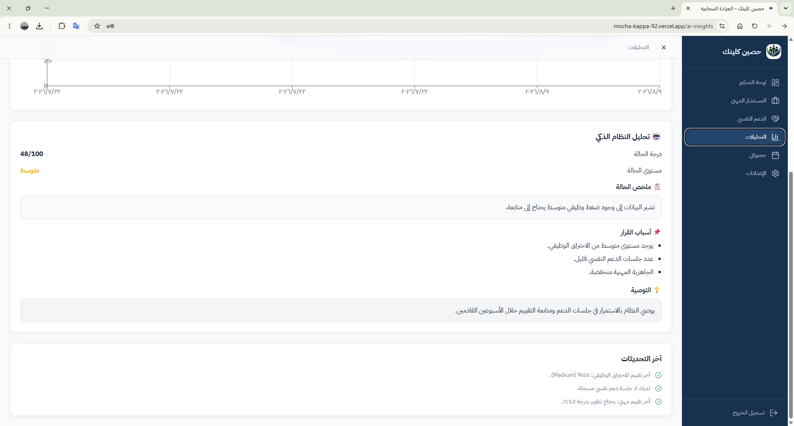

# HASSIN | حصين كلينك
### Cloud Clinic · Workplace Wellbeing Platform

**A collaborative web development project focused on occupational wellbeing, burnout assessment, and digital support services.**

---

## Project Overview

**Hassin (حصين كلينك)** is a cloud-based web platform developed as a collaborative project at **King Khalid University**.

The platform brings together occupational burnout assessment, wellbeing insights, psychological support, professional guidance, and appointment management within a unified digital experience.

The project focuses on creating an accessible and organized web interface that helps users explore workplace wellbeing indicators and access relevant support services.

## My Role & Contributions

**Web Development · Backend Integration · Deployment**

As a member of the Hassin development team, I was directly involved in the technical development and deployment of the web application.

My contributions included:

- **Frontend Development:** Developing and refining responsive web interfaces using React, TypeScript, and Tailwind CSS.
- **Backend Integration:** Connecting the application to Supabase for database operations and cloud-based services.
- **Application Functionality:** Implementing and connecting application pages, components, and user workflows.
- **Deployment:** Configuring and deploying the application through Vercel.
- **Testing & Troubleshooting:** Identifying and resolving technical issues related to navigation, integration, and deployment.
- **Development Workflow:** Using GitHub and GitHub Codespaces for project development and version control.

These contributions reflect my technical involvement as part of a collaborative development team.

## Key Features

| Feature | Description |
| --- | --- |
| **Burnout Assessment** | Assessment interface for evaluating occupational burnout indicators and presenting personalized feedback. |
| **User Dashboard** | Centralized interface displaying wellbeing indicators, assessment results, and available services. |
| **Analytics & Insights** | Interactive visualizations of assessment results, trends, and recommendations. |
| **Psychological Support** | Dedicated interface for accessing psychological support services. |
| **Professional Guidance** | Career-related guidance and consultation services. |
| **Appointment Management** | Interfaces for accessing and managing appointments and bookings. |
| **Account Management** | User registration, login, and account-related settings. |

## Project Screenshots

### 1. Landing Page

The main interface introduces Hassin Cloud Clinic and provides an overview of the platform's purpose and services.

### 2. Analytics Dashboard

The analytics interface presents occupational burnout indicators, wellbeing metrics, and visual trends.

### 3. Assessment Insights

The assessment insights interface displays evaluation summaries, contributing factors, and recommendations.

## Technology Stack

| Category | Technologies |
| --- | --- |
| **Frontend** | React, TypeScript |
| **Styling** | Tailwind CSS |
| **Routing** | React Router |
| **Backend & Database** | Supabase |
| **Deployment** | Vercel |
| **Version Control** | GitHub |
| **Development Environment** | GitHub Codespaces |

## Technical Experience

Working on Hassin provided practical experience in:

- Building and organizing a multi-page React application.
- Developing interfaces with TypeScript and Tailwind CSS.
- Integrating frontend components with cloud-based database services.
- Managing application navigation and user interactions.
- Deploying and maintaining a web application using Vercel.
- Debugging integration and deployment issues.
- Collaborating within a team-based software development workflow.

## Live Demo

Explore the application through the following link:

**[Visit Hassin Cloud Clinic](https://mocha-kappa-92.vercel.app/)**

## Project Credits

Hassin was developed as a collaborative project at **King Khalid University** under the supervision of **Dr. Abeer Al-Almaei**.

**Project Team:**
- Jana Abdulkarim Al-Qahtani
- Rana Abdulrahman Al-Qahtani
- Shumookh Saad Al-Qahtani

This repository showcases my individual technical contributions to the collaborative project through documentation and application screenshots.

---

**Building Digital Solutions Through Web Development & Technology**

