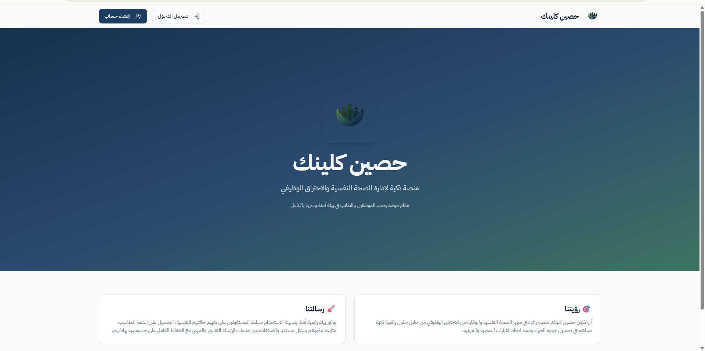
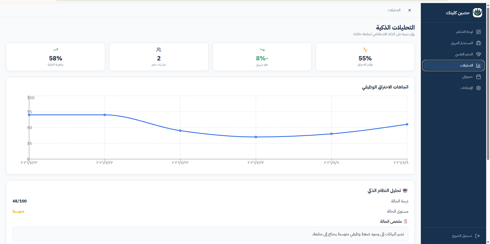
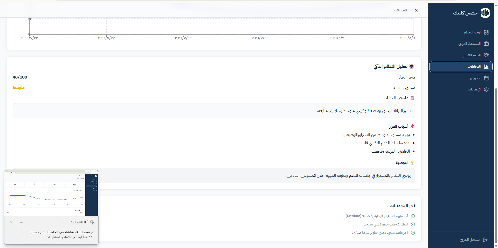

# HASSIN | حصين كلينك
### Cloud Clinic · Workplace Wellbeing Platform

**A team-built web application for occupational burnout assessment, wellbeing insights, and professional support.**

## Project Overview

**Hassin (حصين كلينك)** is a cloud-based web platform developed as a collaborative project at **King Khalid University**. It brings occupational burnout assessment, personalized feedback, psychological-support access, career guidance, and appointment-related services into a unified digital experience.

The platform is intended to help users understand workplace wellbeing indicators and access relevant resources. The published version is a **functional prototype** designed for further development and evaluation—not a clinically validated diagnostic tool.

## My Role & Contributions

**Web Development · Supabase Integration · Deployment**

As a member of the Hassin project team, I contributed directly to the technical implementation and release of the web application, including:

- Developing and refining the website's interfaces using **React, TypeScript, and Tailwind CSS**.
- Connecting the application to **Supabase** for cloud-based backend and database functionality.
- Implementing and connecting application pages and user flows.
- Deploying the web application through **Vercel**.
- Testing the published application and troubleshooting navigation, integration, and deployment issues.
- Working with **GitHub and GitHub Codespaces** as part of the development workflow.

This is a **team project**; the contributions above describe my technical involvement, not sole ownership or authorship of the entire platform.

## Platform Features

| Feature | Description |
| --- | --- |
| **Burnout assessment** | An assessment flow that categorizes occupational burnout indicators and presents result-based feedback. |
| **User dashboard** | A central view of wellbeing indicators, risk level, and available services. |
| **Analytics and insights** | Visual summaries, trends, and explanatory recommendations based on assessment results. |
| **Psychological support** | A dedicated area for accessing support-related services. |
| **Professional guidance** | Career-oriented guidance and consultation workflows. |
| **Appointments** | Pages for accessing and reviewing bookings. |
| **Account management** | Registration, sign-in, and account-related settings. |

## Screenshots

### Landing Page
A public introduction to the platform and its purpose.

### Analytics Dashboard
A visual overview of wellbeing metrics and occupational burnout trends.

### Assessment Insights
An example of the results summary, explanatory factors, and recommendations presented by the platform.

> **Note:** Any values visible in screenshots are illustrative of the application interface and should not be interpreted as verified clinical outcomes.

## Technology Stack

| Layer | Tools |
| --- | --- |
| Frontend | React, TypeScript |
| Styling | Tailwind CSS |
| Routing | React Router |
| Cloud backend and database | Supabase |
| Hosting and deployment | Vercel |
| Version control and development | GitHub, GitHub Codespaces |

## Development Journey

The project progressed from requirements and technology selection through interface development, assessment and analytics screens, backend integration, testing, and deployment. The team addressed routing and navigation issues as well as deployment and environment-configuration challenges along the way.

## Explore

- **Live application:** https://mocha-kappa-92.vercel.app/
- **Official source repository:** https://github.com/ttckku-ship-it/-

## Project Attribution

Hassin is a collaborative university project associated with **King Khalid University** and documented by its project team under the supervision of **Dr. Abeer Al-Almaei**.

The project report identifies team members **Jana Abdulkarim Al-Qahtani, Rana Abdulrahman Al-Qahtani, and Shumookh Saad Al-Qahtani**.

This repository is an **independent professional portfolio showcase** of my participation. It contains documentation and screenshots only; it does **not** duplicate the original application's source code, transfer ownership, or represent an official institutional repository.

---

**Building useful digital experiences through web development and data-informed design.**

